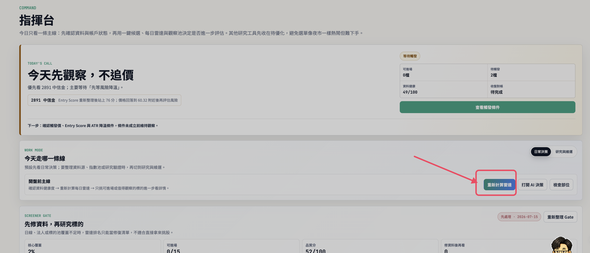

# 每日決策雷達 SOP

這份文件只處理一件事：每天要怎麼跑每日決策雷達、看結果、決定下一步。若你已經啟動 Web 服務，通常照「手動操作」就可以。

## 入口連結

- [本機控制台：指揮台](http://127.0.0.1:8766/#dashboard)
- [本機控制台：AI 決策](http://127.0.0.1:8766/#pipeline)
- [README 主頁](../README.md)
- [Phase 1 驗收說明](decision_radar_phase1_acceptance.md)
- [Phase 1 測試紀錄](decision_radar_phase1_test_journal.md)

## 手動操作

如果服務已經啟動：

```bash
.venv/bin/python run_web.py --host 127.0.0.1 --port 8766
```

每天盤前照這樣做：

1. 開啟 [本機控制台：指揮台](http://127.0.0.1:8766/#dashboard)。
2. 確認畫面上方不是 API 401；如果有 401，先到「設定」貼上 `CONTROL_PANEL_TOKEN`，或在本機把 `.env` 的 `CONTROL_PANEL_TOKEN=` 留空後重啟服務。
3. 在「今天走哪一條線」區塊按 `重新計算雷達`。
4. 等待按鈕執行完成後，看 `候選可信度 Gate`、`日常決策雷達驗收`、`每日雷達` 的數字。
5. 如果 `可進場` 是 0，不代表錯誤；先看 `只觀察` 與 `不碰` 的理由是否清楚。



## CLI 手動跑法

如果你不想用畫面，也可以直接在 VS Code Terminal 跑：

```bash
.venv/bin/python -m app.cli run-daily-radar-job --universe curated_watchlist --risk-profile balanced --notify none
.venv/bin/python -m app.cli decision-radar-phase1-acceptance
.venv/bin/python -m app.cli ops-readiness --target-phase paper --include-intraday-quote-review
```

## 每天檢查節奏

盤前：

1. 跑 `重新計算雷達`，或用 CLI 跑 `run-daily-radar-job`。
2. 看 `候選可信度 Gate`：資料品質不夠時，先補資料，不要急著研究標的。
3. 看 `今日決策結論`：它會告訴你今天偏向可行動、觀察，或先暫停。
4. 看 `日常決策雷達驗收`：Phase 1 期間要連續 2 到 3 個交易日記錄結果。

盤中：

1. 只有在有 `只觀察` 或等待觸發標的時，才需要看 `觸發觀察監控`。
2. 若要手動檢查觸發條件：

```bash
.venv/bin/python -m app.cli daily-radar-trigger-monitor --price-source shioaji_snapshot --notify none
```

盤後：

1. 做今日摘要：

```bash
.venv/bin/python -m app.cli eod-summary
```

2. 再跑一次營運總檢：

```bash
.venv/bin/python -m app.cli ops-readiness --target-phase paper --include-intraday-quote-review
```

## 想每天自動跑

如果你只是本機開著 VS Code，最簡單是每天手動按 `重新計算雷達`。如果想讓它固定時間自動跑，有兩種方式。

方式一：啟動常駐排程，終端機要保持開著。

```bash
.venv/bin/python -m app.cli run-scheduler --enable-daily-radar --radar-hour 8 --radar-minute 45 --radar-universe curated_watchlist --notify none
```

方式二：產生 macOS launchd 檔案，適合之後改成背景排程。

```bash
.venv/bin/python -m app.cli write-launchd-plist --hour 8 --minute 45 --universe curated_watchlist --notify none --notify-style premarket
```

這個指令只會把 plist 寫到 `deploy/launchd/`，不會自動載入系統排程。第一次建議先用手動或常駐排程，確認輸出穩定再進一步安裝 launchd。

## 判讀規則

- `可進場`：可以進一步研究，但仍不是自動下單。
- `只觀察`：條件接近，等價格、Entry Score、ATR 或風控條件完成。
- `不碰`：目前風險、資料品質或候選分數不適合。
- `資料健康` 太低：先處理資料，不要把時間花在候選解讀。
- `Phase 1 通過` 前：只做連續測試與人工判讀，不進 Phase 2。

